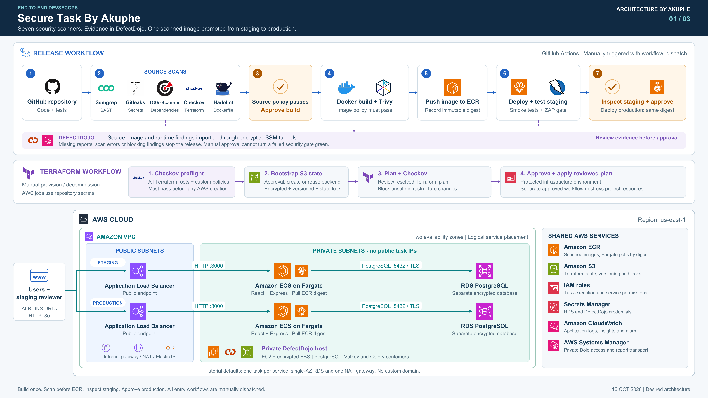

# AWS DevSecOps Project

**Secure Task By Akuphe · Build. Scan. Review. Deploy.**

A complete delivery pipeline for a full-stack task management application. Provision AWS infrastructure with Terraform, investigate security findings in DefectDojo, scan the Docker image before publishing it to Amazon ECR, and deploy to ECS Fargate through staging and production approval gates.

**React · TypeScript · Express · PostgreSQL · Docker · Terraform · GitHub Actions**

[Architecture](#architecture) · [Run locally](#run-locally) · [Security tools](#security-tools) · [GitHub Actions](#github-actions) · [Security demonstrations](#security-demonstrations) · [Cleanup](#cleanup)

> **Region:** `us-east-1` · **Compute:** ECS Fargate · **Access:** AWS-generated load balancer URLs · **Workflows:** manually triggered

## What you will build

- A working application with account registration, sign-in, projects, tasks, comments, and activity history.
- Infrastructure checks that can stop an unsafe Terraform configuration before AWS provisioning begins.
- Source, dependency, secret, Dockerfile, container-image, and running-application security checks.
- Centralized findings in DefectDojo, with remediation history and review before release.
- A staged deployment process that promotes the **same scanned image digest** to production after approval.

## Architecture



[Open the full-resolution diagram](docs/assets/architecture/SecureTask-AWS-Architecture.png) · [Scalable SVG](docs/assets/architecture/SecureTask-AWS-Architecture.svg) · [Diagram credits](docs/assets/architecture/CREDITS.md)

The diagram brings together three parts of the project:

| Area | How it works |
| --- | --- |
| **Infrastructure** | GitHub Actions runs Checkov before AWS provisioning, creates or reuses the S3 Terraform backend, scans the resolved plan, and applies the reviewed plan after approval. |
| **Delivery** | Test and scan the source, upload findings to DefectDojo, approve the build, scan the built image with Trivy, and publish the passing image to ECR. |
| **Runtime** | Public Application Load Balancers forward requests to private ECS Fargate services. Staging and production have separate RDS PostgreSQL databases. |

Both environments share the VPC, ECS cluster, ECR repository, and supporting services. DefectDojo runs on a separate private EC2 host with encrypted EBS storage; its database and worker containers are separate from the application's RDS databases. Systems Manager provides private dashboard access and report transport.

**No custom domain is required.** Each application environment has its own AWS-generated ALB DNS endpoint. The tutorial uses explicit `http://` access to those endpoints.

## Run locally

### 1. Open your project folder

Start **Docker Desktop**, then open a terminal in the existing project root—the folder containing `docker-compose.yml`, `Dockerfile`, and `package.json`.

For the local application, Docker Desktop with Docker Compose is sufficient. Docker builds the frontend and backend and starts PostgreSQL; you do not need to install Node.js, PostgreSQL, Terraform, or AWS CLI on your computer for this path.

### 2. Build and start the application

```bash
docker compose up --build -d
```

The first build can take a few minutes. Compose starts PostgreSQL first, waits for its health check, and then starts the application. The application creates its database tables during startup.

The Compose file includes local development defaults, so creating a `.env` file is optional. If you choose to customize the database password, set `DB_PASSWORD` in your local `.env` file.

### 3. Open the application

**Application:** [http://127.0.0.1:3000](http://127.0.0.1:3000)

Register a test account with a password of **at least 12 characters**. Create a project, add a task, change its status or priority, and refresh the page to confirm the data persists.

| Local service | Address |
| --- | --- |
| Web application and API | `http://127.0.0.1:3000` |
| PostgreSQL from your computer | `127.0.0.1:55432` |
| PostgreSQL from the app container | `db:5432` |

The `app` container serves the built React frontend and Express API together. A separate `db` container runs PostgreSQL, with its data stored in a named Docker volume.

### 4. Confirm readiness

```bash
docker compose ps
curl --fail http://127.0.0.1:3000/health/ready
```

Expected readiness response:

```json
{"status":"ready"}
```

The readiness endpoint checks database connectivity. The separate `/health/live` endpoint returns `{"status":"ok"}` when the server is running.

### Useful local commands

| Action | Command |
| --- | --- |
| View application logs | `docker compose logs -f app` |
| View database logs | `docker compose logs -f db` |
| Rebuild after changing code | `docker compose up --build -d` |
| Stop the project and keep database data | `docker compose down` |
| Start it again | `docker compose up -d` |

To deliberately reset the local database and remove its stored accounts, projects, and tasks:

```bash
docker compose down --volumes
```

### Local troubleshooting

| Symptom | What to check |
| --- | --- |
| `no configuration file provided: not found` | Your terminal is in the wrong directory. Open the folder containing `docker-compose.yml` and run the command there. |
| Cannot connect to the Docker daemon | Open Docker Desktop and wait for its engine to finish starting. |
| Port `3000` or `55432` is already allocated | Stop the conflicting local service, or change the host-side port mapping in `docker-compose.yml`. |
| The page does not open yet | Check `docker compose ps`, then inspect `docker compose logs -f app` and `docker compose logs -f db`. Wait for initialization to finish. |
| Database authentication fails after changing `DB_PASSWORD` | An existing volume keeps its original database credentials. Use the original password, or reset the local volume if you intend to discard its data. |

## Security tools

The project uses **seven scanners**, each covering a different part of the delivery process.

| Tool | Security check | Where it runs |
| --- | --- | --- |
| **Semgrep** | Static analysis for unsafe source-code patterns | Source checks |
| **Gitleaks** | Exposed credentials and other secrets in Git history | Source checks |
| **OSV-Scanner** | Known vulnerabilities in application dependencies | Source checks |
| **Checkov** | Terraform configuration, custom infrastructure policies, and the resolved platform plan | Infrastructure and source checks |
| **Hadolint** | Dockerfile instructions and build practices | Source checks |
| **Trivy** | OS-package and application-dependency vulnerabilities in the built Docker image | Before ECR publishing |
| **ZAP** | Unauthenticated baseline security checks against the running web application | After staging deployment |

**DefectDojo is the findings platform.** It receives source, image, and runtime reports so you can investigate findings and track fixes. It is separate from the seven scanners.

The configured policy blocks **High and Critical** findings, blocks findings from **Gitleaks** regardless of severity, and fails when required scan evidence is missing or invalid. Medium and Low findings still need review; passing the gate is not a guarantee of zero vulnerabilities.

Understand the purpose of each check. You can use other tools in your own pipeline while preserving the same principles: scan, keep evidence, enforce policy, investigate, remediate, and verify.

## GitHub Actions

### Workflows you trigger

Open the repository's **Actions** tab, choose a workflow, and select **Run workflow**. Use the `main` branch for the AWS workflows. Pushing a commit does not start a deployment automatically.

| Workflow | Purpose |
| --- | --- |
| **Manual source checks** | Build, test, and scan the normal project scope. |
| **Provision AWS infrastructure** | Run Checkov preflight, bootstrap the S3 backend, review and scan the Terraform plan, then approve and apply it. |
| **Record security challenges** | Scan the demonstration fixtures and upload their findings to DefectDojo for the walkthrough. |
| **Secure release** | Run the complete source-to-production delivery process. |
| **Decommission all project infrastructure** | Review and approve removal of the project-managed AWS resources. |

`deploy.yml` is a reusable deployment workflow called by **Secure release**; it is not a separate manual entry point.

### AWS setup through the pipeline

Use your existing GitHub repository with `main` as its default branch. The tutorial's environment-setup script expects a **public repository** for its required-reviewer gates. See [GitHub's environment documentation](https://docs.github.com/en/actions/reference/workflows-and-actions/deployments-and-environments#required-reviewers) for plan availability.

Add these repository secrets under **Settings → Secrets and variables → Actions**:

| Secret | Purpose |
| --- | --- |
| `AWS_ACCESS_KEY_ID` | AWS authentication for the pipeline's cloud jobs. |
| `AWS_SECRET_ACCESS_KEY` | The matching AWS secret access key. |
| `REPO_ADMIN_TOKEN` | Repository-scoped GitHub setup token with Administration, Environments, and Variables read/write permissions. It configures approval environments and publishes repository variables. |
| `AWS_SESSION_TOKEN` | Include this when using temporary AWS credentials. |

The GitHub setup token **configures** the gates; the designated reviewer **approves** paused jobs. Use the dedicated AWS lab account described in the [Project Book](docs/PROJECT-BOOK.md).

Run **Provision AWS infrastructure** with your 12-digit AWS account ID. The workflow checks the infrastructure first, then creates or reuses the state bucket and provisions the platform through Terraform. No local Terraform deployment commands are needed.

### Release sequence

1. **Test and scan.** Build and test the application, then run the five source/configuration scanners.
2. **Report and enforce policy.** Upload source findings to DefectDojo. Blocking findings stop the release before the Docker build.
3. **Review and approve the build.** Inspect the reports, then approve the `security-review` environment when the source policy passes.
4. **Build and scan the image.** Build once, scan with Trivy, upload the container findings, and enforce image policy before publishing to ECR.
5. **Deploy staging.** Deploy the scanned ECR image by digest, run application checks and ZAP, and upload the runtime findings.
6. **Inspect staging.** Open the staging URL and verify registration, sign-in, project/task updates, and persistence.
7. **Approve production.** Use **Review deployments → production → Approve and deploy** to promote the **same image digest**, without rebuilding it.

Reject the production approval to stop promotion and keep staging available for investigation. A manual approval is reached only after its prerequisite security jobs pass.

### Find the staging and production URLs

- Open the deployment job's summary or its **Publish application URL and next step** step.
- Alternatively, open **AWS Console → EC2 → Load Balancers**, select the staging or production ALB, and copy its **DNS name**. Open it with the tutorial's `http://` prefix.
- The infrastructure workflow also publishes `STAGING_URL` and `PRODUCTION_URL` as GitHub repository variables.

The ALBs exist after infrastructure provisioning, but the application endpoint becomes usable after the corresponding ECS service has been deployed and is healthy.

## AWS services

| Service | Role in the project |
| --- | --- |
| **Amazon VPC** | Public and private subnets across two availability zones, routing, and security groups. |
| **Application Load Balancers** | Separate public endpoints for staging and production. |
| **Amazon ECS with AWS Fargate** | Runs the application containers in private subnets without public task IPs. |
| **Amazon ECR** | Stores the scanned application image for deployment by immutable digest. |
| **Amazon RDS for PostgreSQL** | Separate encrypted application databases for staging and production. |
| **Amazon S3** | Encrypted, versioned Terraform state with state locking. |
| **AWS IAM** | Runtime, task-execution, and service permissions. |
| **AWS Secrets Manager** | RDS credentials and DefectDojo administrator/integration secrets. |
| **Amazon CloudWatch** | Application logs, monitoring, and alarms. |
| **Amazon EC2 and EBS** | Private DefectDojo host and encrypted storage. |
| **AWS Systems Manager** | Private DefectDojo access and encrypted report transport. |
| **Internet Gateway, NAT Gateway, and Elastic IP** | Public routing and outbound connectivity from private subnets. |

The tutorial uses one task per application service, single-AZ RDS instances, one NAT gateway, and HTTP ALB endpoints. These are lab defaults; a two-AZ subnet layout alone does not make the application highly available. AWS resources incur charges while provisioned.

## Security demonstrations

The video demonstrates four issue types and how the pipeline catches them:

| Layer | Demonstrated issue | Correction |
| --- | --- | --- |
| Infrastructure | Incomplete S3 public-access protection | Enable all four public-access controls. |
| Infrastructure | Unencrypted RDS storage | Enable `storage_encrypted`. |
| Application source | SQL query built from interpolated input | Use a parameterized query. |
| Application source | Dynamically evaluating JavaScript input | Parse the expected value and validate it. |

**The completed checkout already contains these fixes.** A clean scan can therefore pass. The source examples live in `security/demo/` and are excluded from the Docker image.

To include the two source exercises in a release scan, enable **`include_remediation_demo`** when starting **Secure release**. **Manual source checks does not include those optional exercises.** Including corrected files does not create artificial findings.

For a failing-then-fixed recording, follow the [infrastructure demonstration](docs/INFRASTRUCTURE-SECURITY-DEMO.md) and the remediation walkthrough in the [Project Book](docs/PROJECT-BOOK.md). After applying fixes and pushing them, start a **new workflow run at the updated commit**, keeping the exercise option enabled. Rerunning an old failed job uses that run's original commit.

## Cleanup

### Local containers

```bash
docker compose down
```

The local database volume remains available for your next run. Use the separately described `--volumes` option only when you intend to reset local data.

### AWS infrastructure

Run **Decommission all project infrastructure** from GitHub Actions. Enter the AWS account ID and the exact confirmation requested by the workflow:

```text
DESTROY securetask
```

Review the deletion plan, then approve the `decommission` environment. The workflow removes the project-managed application and platform resources and deletes the state bucket last. Confirm that its `decommission-result` artifact reports completion.

The GitHub repository, workflow artifacts, dedicated provisioning IAM user, and externally supplied credentials are outside Terraform's project ownership. Follow the [Project Book](docs/PROJECT-BOOK.md) to finish their cleanup after the workflow succeeds.

## Project layout

```text
.
├── .github/workflows/     # Manually triggered workflows and reusable ECS deployment
├── backend/              # Express API, authentication, database access, and migrations
├── frontend/             # React application
├── infra/
│   ├── bootstrap/        # Terraform state backend
│   ├── platform/         # Network, ECR, ECS cluster, ALBs, RDS, and DefectDojo host
│   └── application/      # Initial per-environment ECS service and task definition
├── security/             # Scanner configuration, policy, custom checks, and exercises
├── scripts/              # Scan, report, deployment, approval, and cleanup helpers
├── tests/                # Application and pipeline-support checks
├── dojo/                 # DefectDojo container configuration
├── docs/                 # Project book, architecture assets, and tutorial guides
├── docker-compose.yml    # Local application and PostgreSQL
└── Dockerfile            # Multi-stage application image
```


---

**Built by Akuphe · Practical DevOps, DevSecOps, and cloud engineering.**
