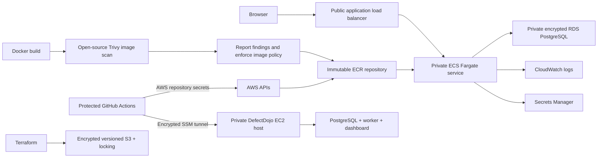

# Architecture

The application uses ECS Fargate in private subnets with no public task IPs. Staging and production use separate public Application Load Balancers (ALBs) and separate RDS instances. They share the VPC, ECS cluster, ECR repository, and log group. Separate databases prevent runtime scans or staging work from modifying production data.

A single NAT gateway provides private-subnet outbound connectivity. This is a cost-conscious tutorial choice, not a highly available multi-AZ egress design. RDS defaults to a single AZ. Each ECS service defaults to one task. Raise desired counts, enable multi-AZ RDS, and use resilient egress for a production system.

## Ownership

- Bootstrap Terraform: encrypted, versioned state bucket with project ownership tags and a private bootstrap-state snapshot.
- Platform Terraform: networking, registry, clusters, databases, load balancers, runtime roles, logging, private DefectDojo host.
- Application Terraform: initial task definition and ECS service per environment.
- Release workflow: subsequent task-definition revisions and image changes. Terraform ignores the service's task_definition field so a platform maintenance apply does not revert a release.

Dojo host AMI and user data changes are ignored after instance creation to avoid disrupting the dashboard during Terraform maintenance. Update its integration using `configure-dojo-host.py`. Updating the upstream Dojo image/version requires a deliberate host maintenance operation and database backup.

## Trust and permissions

Manually dispatched source checks have no AWS permissions or Dojo token. Release scans receive no cloud credentials. Pinned scanner containers receive a copy of tracked/non-ignored source, never local ignored secrets or Terraform state, and do not receive a Docker socket.

AWS jobs authenticate using repository secrets. These provisioning credentials have broad permissions in the dedicated sandbox; they are external to Terraform so cleanup keeps working until the last resource is deleted. Scanner-only jobs receive no AWS secrets. The application task role has no attached AWS permissions; runtime execution and Dojo roles retain their service-specific permissions. OIDC temporary credentials are an optional future enhancement, not part of this simplified tutorial path.

Terraform plan artifacts may contain infrastructure details and potentially sensitive state if the configuration is later extended. Retention is one day. Restrict repository access and do not upload plan files to a public website.

The application currently uses the RDS-managed master account for tutorial simplicity. A production deployment should separate migration privileges from a minimally privileged runtime database user, integrate managed identity/user authentication, and adopt versioned backward-compatible migrations.

HTTP is an explicit tutorial setting. It removes transport protection for the application endpoint. The private Dojo token is transported through encrypted SSM, and RDS connections still validate TLS. Use test data for the public HTTP application.

## Manual decommissioning

The decommission workflow reviews production, staging, platform, and bootstrap on main and requires an account confirmation and protected environment approval. It verifies state hashes before changing resources. The private bootstrap snapshot lives at `bootstrap/terraform.tfstate`; the destroy runner uses a local copy so deleting S3 does not prevent its final state write. Repository-secret AWS credentials survive deletion of project-managed runtime roles and the state bucket. The dedicated provisioning IAM user and repository secrets remain outside Terraform and are revoked by the administrator after teardown.

All entry-point workflows use workflow_dispatch. The deployment helper uses workflow_call only and runs inside a manually started release. AWS-mutating entry points share a concurrency group; all infrastructure mutations use those workflows.

## Remediation recording

Secure release can include two scan-only source exercises. Its first run uploads the SQL/eval findings to the Dojo remediation engagement and fails source policy before Docker build. A new manually dispatched run at the corrected commit reuses that engagement and its scanner Test IDs. Empty reimports close absent findings as mitigated and retain history. Normal source scans use main, so turning off the exercise option cannot close remediation findings. Once source policy passes, the same release waits for approval and continues through Trivy, ECR, Fargate, ZAP, and production review.
